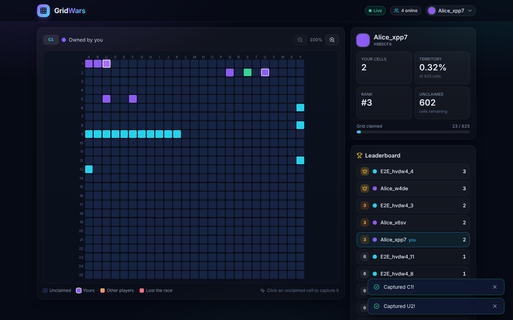
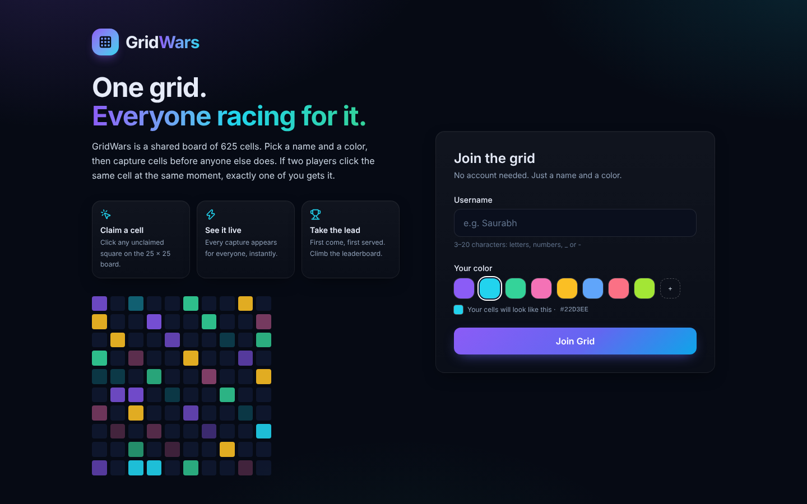
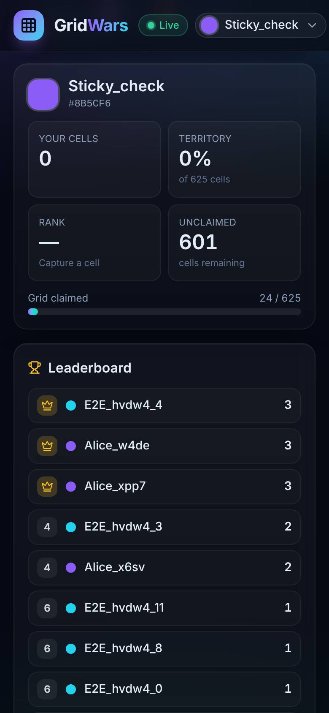
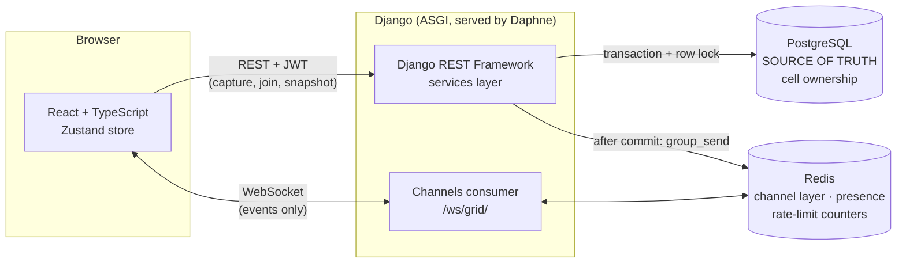
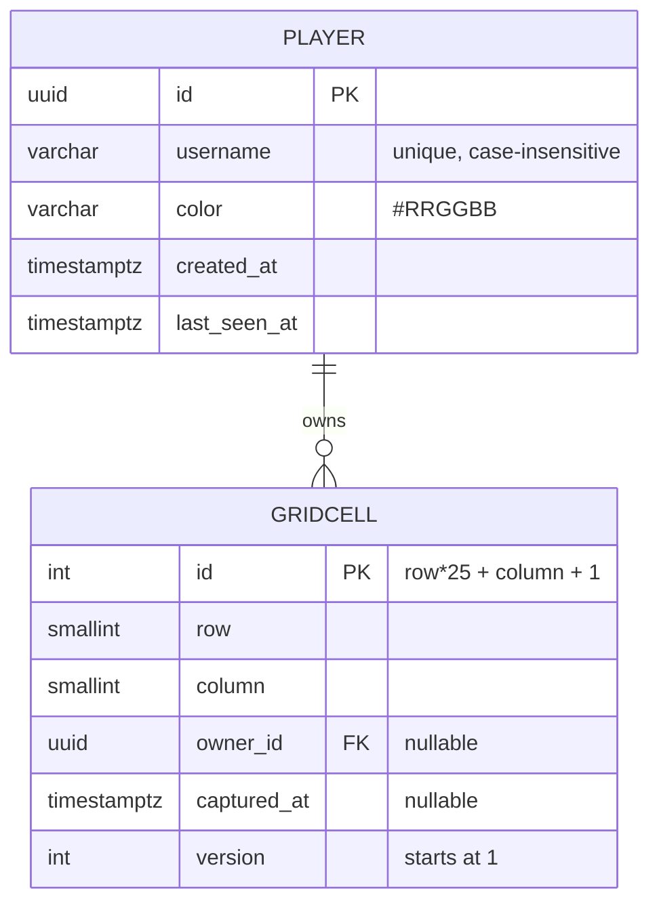
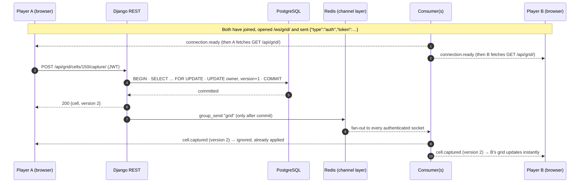

# GridWars

**A real-time multiplayer grid.** Join with a name and a color, then race other players to capture cells on a shared
25 × 25 board. Every capture appears for everyone instantly, and if two players click the same cell at the same
moment, **exactly one wins**. That guarantee is enforced by PostgreSQL row locks, not by the browser.



## Contents

[Features](#features) · [Screenshots](#screenshots) · [Architecture](#architecture) · [Tech stack](#tech-stack) ·
[Database design](#database-design) · [WebSocket flow](#websocket-communication-flow) ·
[Concurrency](#how-concurrent-captures-stay-correct) · [API](#rest-api) · [Local setup](#local-setup) ·
[Tests](#tests) · [Deployment](#deployment) · [Limitations](#known-limitations-and-future-improvements)

## Features

- **Guest join**: username + color, no account. The server issues a signed JWT.
- **Shared 25 × 25 grid** (625 cells) restored from the database on every refresh.
- **Real-time updates** over WebSockets: captures, online-player count, leaderboard and an activity feed update without refreshing.
- **Race-safe captures**: simultaneous clicks on one cell → one `200`, everyone else `409` with a clear "Too slow!" message.
- **Resilient connection**: automatic reconnect with jittered exponential backoff, heartbeat to detect dead connections, and a fresh snapshot after every reconnect so missed captures are recovered.
- **Polished UI**: dark theme, per-cell animations (pending, captured, lost-the-race), toasts, skeleton loading, error and empty states, zoom, keyboard navigation, responsive layout down to phone width.
- **Hardening**: rate limiting, username/color validation, origin-checked WebSockets, no tokens in URLs, sanitized errors.

## Screenshots

| Welcome | Game (desktop) | Game (mobile) |
|---|---|---|
|  |  |  |

## Architecture



**PostgreSQL is the only authority on who owns a cell. Redis only distributes events** (and holds transient data:
presence and rate-limit counters). If Redis is wiped nothing is lost; clients resync from the database.

Key decisions:

| Decision | Why |
|---|---|
| Captures go over **REST**, not the WebSocket | A normal request/response with proper status codes (`409`), auth, throttling and tests. The socket is receive-only for game state, so a client cannot claim a cell through it. |
| Events are published **after commit** | A rolled-back or failed capture can never be announced. |
| Every cell has a **`version`** | Clients apply an update only if it is newer, so duplicate or out-of-order events can't overwrite fresh state. |
| **Snapshot on every connect** | Closes the gap between "first fetch" and "socket authenticated", and after any outage. |
| Leaderboard **derived from the grid** on the client | The grid is version-guarded, so the leaderboard can never disagree with it or move backwards. |
| JWT sent as the **first WebSocket message** | Tokens in URLs leak into logs and history. An unauthenticated socket is in no broadcast group. |

### Project structure

```
gridwars/
├── backend/
│   ├── config/        settings/{base,dev,test,prod}.py · asgi.py · urls.py · exceptions.py · throttles.py · health.py
│   ├── accounts/      Player model · username/color validation · guest join service · JWT issue
│   ├── grid/          GridCell model · capture service (locking) · serializers · views · seed_grid command
│   ├── realtime/      consumer · event contract & publishing · presence · origin middleware
│   ├── tests/         95 tests (incl. real-thread concurrency tests on PostgreSQL)
│   ├── scripts/start.sh · Dockerfile · .env.example
├── frontend/
│   └── src/
│       ├── api/       axios client (typed errors) · endpoints · types
│       ├── realtime/  GridSocket (reconnect, heartbeat) · event validation · backoff
│       ├── store/     Zustand game & toast stores · selectors
│       ├── services/  gameController (all side effects) · session storage
│       ├── components/ pages/ lib/
│       └── test/      108 tests
├── docs/DEPLOYMENT.md · docs/screenshots/
├── scripts/live-race-check.mjs   end-to-end race check against a running backend
├── docker-compose.yml            Postgres + Redis (+ backend) for local use
└── .env.example
```

## Tech stack

| Layer | Technology |
|---|---|
| Frontend | React 19, TypeScript, Vite, Tailwind CSS 4, Lucide icons, Axios, native WebSocket, Zustand |
| Backend | Python 3.11+ (tested on 3.13 only), Django 5.2, Django REST Framework, Django Channels, Daphne, SimpleJWT, drf-spectacular |
| Data | PostgreSQL (authoritative), Redis (channel layer, presence, throttling) |
| Testing | pytest + pytest-django (real PostgreSQL), Vitest + Testing Library |

## Database design



Integrity is enforced **in the database**, not just in Python:

| Rule | Mechanism |
|---|---|
| One row per coordinate | `UNIQUE (row, column)` |
| Coordinates inside the 25 × 25 grid | `CHECK (row, column in 0..24)` |
| Cell id matches its coordinates | `CHECK (id = row*25 + column + 1)` |
| Owner and timestamp set together | `CHECK` (both null or both set) |
| **A captured cell can't be reassigned** | `BEFORE UPDATE` **trigger** (migration `grid/0002`) raises if `owner_id` changes once set |
| Usernames unique ignoring case ("Neo" = "neo") | `UNIQUE (lower(username))` |
| Colors are valid hex | `CHECK` regex |

`python manage.py seed_grid` creates all 625 cells; it is idempotent and never touches ownership. (`--reset` deletes everything and is explicit.)

## WebSocket communication flow



**Server → client events** (`{"type": …, "data": {…}}`):

| Type | When |
|---|---|
| `connection.ready` | After successful authentication (clients then fetch a snapshot) |
| `cell.captured` | A cell changed owner: `cell_id, row, column, owner{id,username,color}, captured_at, version` |
| `presence.updated` | Number of distinct online players changed |
| `leaderboard.updated` | Top players + totals after a capture (available to clients; the web client derives its own) |
| `pong` | Reply to a client `ping` heartbeat |
| `error` | `invalid_token`, `auth_timeout`, `malformed_message`, `message_too_large`, `unknown_message_type`, … |

**Client → server:** only `auth` and `ping`. Anything else is an error.
**Close codes:** `4401` auth failed/timeout, `4400` malformed/oversized, `1013` realtime service unavailable.

**Reconnection:** the client retries with exponential backoff and jitter (500 ms → 15 s cap), immediately when the
browser comes back online or the tab becomes visible, detects dead connections with a 20 s ping / 10 s pong timeout,
re-authenticates, and refetches the full grid. A rejected token (`invalid_token`) ends the session instead of looping.

## How concurrent captures stay correct

The capture service (`backend/grid/services.py`) runs inside one transaction:

```python
with transaction.atomic():
    # Row lock on the cell only. A competing transaction blocks here until we commit.
    cell = GridCell.objects.select_for_update(of=("self",)).select_related("owner").get(pk=cell_id)

    if cell.owner_id is not None:                      # checked AFTER the lock, so it can't be stale
        raise CellAlreadyCaptured(...)                 # → HTTP 409

    GridCell.objects.filter(pk=cell.pk, owner__isnull=True).update(   # conditional UPDATE, second guard
        owner=player, captured_at=now, version=F("version") + 1)

    transaction.on_commit(lambda: publish(...))        # broadcast only if the commit succeeds
```

1. **Row lock:** two players racing for cell 150 serialize on that row. The loser wakes up *after* the winner commits, sees an owner, and gets `409`. Captures of *different* cells don't wait for each other.
2. **Conditional update + DB trigger:** even if application code were wrong, PostgreSQL itself refuses to reassign an owned cell.
3. **Identity from the token:** the owner is `request.user` from the verified JWT. Any `owner` sent in the body is ignored (there is a test for this).
4. **Broadcast after commit:** failed or rolled-back captures are never announced; a Redis failure is logged and swallowed (the capture already succeeded) and clients resync on reconnect.

Tests run **real threads against real PostgreSQL** with a barrier so requests start together: 2-way and 20-way races on one
cell, a same-player double click, 15 players on different cells (all succeed), a 30-player burst over 10 cells (each cell
ends with exactly one owner), and the same race through the full HTTP stack (10 clients → one `200`, nine `409`).

## REST API

Interactive docs: **`/api/docs/`** (Swagger UI) · schema: `/api/schema/`. All endpoints except `join` and `health` need `Authorization: Bearer <token>`.

| Method | Path | Result |
|---|---|---|
| `POST` | `/api/players/join/` | `201 {token, token_type, expires_in, player}` · `400` invalid · `409 username_taken` · `429` |
| `GET` | `/api/players/me/` | player + stats (cells, percentage, rank) |
| `GET` | `/api/grid/` | all 625 cells + `server_time` |
| `GET` | `/api/grid/stats/` | totals, unclaimed, players |
| `POST` | `/api/grid/cells/{id}/capture/` | `200` cell · **`409 cell_already_captured`** · `404 cell_not_found` · `400` malformed id · `429` · `401` |
| `GET` | `/api/leaderboard/?limit=` | ranked players (ties share a rank) |
| `GET` | `/api/health/` | `200` ok/degraded · `503` database down |

**Every error has the same shape:** `{"error": {"code": "…", "message": "…", "details": {…}}}`. Database errors return a generic
`503`; internals never reach the client.

## Local setup

**Prerequisites:** Python 3.11+, Node 22, PostgreSQL and Redis, *or* Docker for those two. Developed and tested on Python 3.13, Node 22, PostgreSQL 16 and Redis 7; other versions are untried.

### 1. Start PostgreSQL and Redis

With Docker (binds to `127.0.0.1` only):

```bash
cp .env.example .env            # local-dev defaults, match backend/.env.example
docker compose up -d db redis
```

Without Docker, install them yourself and create a role and database named `gridwars` (password `gridwars`), or edit `DATABASE_URL`.
Redis is optional locally: leave `REDIS_URL` empty and an in-memory channel layer is used (single process only).

### 2. Backend

```bash
cd backend
python3 -m venv .venv && source .venv/bin/activate
pip install -r requirements-dev.txt
cp .env.example .env            # adjust if your DB/Redis differ
python manage.py migrate
python manage.py seed_grid      # creates the 625 cells (safe to repeat)
python manage.py runserver      # http://localhost:8000  (Daphne serves HTTP + WebSocket)
```

Check it: <http://localhost:8000/api/health/> and <http://localhost:8000/api/docs/>.

### 3. Frontend

```bash
cd frontend
npm install
cp .env.example .env            # VITE_API_BASE_URL / VITE_WS_URL (defaults already point at localhost:8000)
npm run dev                     # http://localhost:5173
```

Open it in **two different browsers** (or one normal + one private window; each needs its own guest session), join with different names, and capture.

### Environment variables

| File | Purpose |
|---|---|
| [`backend/.env.example`](backend/.env.example) | `SECRET_KEY`, `DEBUG`, `ALLOWED_HOSTS`, `DATABASE_URL`, `REDIS_URL`, `CORS_ALLOWED_ORIGINS`, JWT and throttling settings |
| [`frontend/.env.example`](frontend/.env.example) | `VITE_API_BASE_URL`, `VITE_WS_URL` |
| [`.env.example`](.env.example) | `docker-compose.yml` only |

Real `.env` files are git-ignored. **`config.settings.prod` refuses to start** if `SECRET_KEY` (≥ 32 chars), `ALLOWED_HOSTS`,
`CORS_ALLOWED_ORIGINS`, `DATABASE_URL` or `REDIS_URL` is missing.

## Tests

```bash
# Backend: needs PostgreSQL running (concurrency tests must use the real engine). 95 tests, ~12 s
cd backend && source .venv/bin/activate && python -m pytest

# Frontend: 108 tests, ~10 s
cd frontend && npm test
npm run typecheck && npm run lint && npm run build
```

| Area | What is covered |
|---|---|
| Grid | exactly 625 cells · idempotent seeding · coordinate/ownership constraints · DB trigger blocks reassignment |
| Players | join · invalid/reserved/offensive usernames · case-insensitive duplicates · invalid colors · rate limit · token tampering |
| Capture | success · own/other's cell → `409` · unauthenticated `401` · invalid ids · owner comes from the token · throttling · DB errors don't leak details |
| WebSocket | first-message auth · invalid/expired/unknown-player tokens · token in URL rejected · auth timeout · malformed & oversized messages · origin allow-list · capture events delivered · **failed captures not broadcast** · presence · channel-layer failure |
| Concurrency | real-thread races on PostgreSQL (see above) · only the winner is published · rollback publishes nothing |
| Frontend | grid rendering (625 cells, all states, ARIA labels) · click → capture · owned/pending cells inert · hover info · keyboard navigation · zoom · join form validation and server errors · stale/duplicate event handling · snapshot merge · socket reconnect/backoff/heartbeat/auth-failure · full app flow with faked network edges |

**End-to-end against a running stack** (not part of the unit suites):

```bash
# terminal 1: backend with the real Redis layer
cd backend && REDIS_URL=redis://127.0.0.1:6379/0 DJANGO_SETTINGS_MODULE=config.settings.dev \
  daphne -b 127.0.0.1 -p 8000 config.asgi:application
# terminal 2: 12 players, 12 sockets, a 12-way race, offline-then-resync, auth hardening (18 checks)
node scripts/live-race-check.mjs
```

## Deployment

See **[docs/DEPLOYMENT.md](docs/DEPLOYMENT.md)** for hosting requirements, provider limits (checked and dated),
environment variables, build/start commands, deployment order and a verification checklist.

The short version: the backend must run as a **long-lived ASGI process with WebSocket support**, with PostgreSQL and
Redis behind it. Start command: `sh scripts/start.sh` (migrate → seed → Daphne). Health check: `/api/health/`.
Frontend: `npm run build`, publish `dist/`, with `VITE_API_BASE_URL` and `VITE_WS_URL` (`wss://`) set at build time.

## Security notes

- Cell owner is always taken from the verified JWT, never from the request. WebSocket clients cannot send captures.
- JWT is **not** placed in WebSocket URLs; the socket is in no broadcast group until it authenticates (5 s deadline).
- Browser WebSocket connections must come from `CORS_ALLOWED_ORIGINS`. Rate limits on join (per IP) and capture (per player) fail **open** if the cache is down, so an outage degrades protection instead of the game.
- The session token is kept in `localStorage`: simple and fine for a guest game with no personal data, but readable by any script on the page (XSS). An `HttpOnly` cookie would be the hardening step if this held real accounts.
- The API has no cookies or sessions, so CSRF protection is intentionally not enabled.

## Known limitations and future improvements

Honest list of what this does **not** do or has **not** been verified:

- **Not deployed or Docker-built here.** Production settings and the start script were exercised against real PostgreSQL/Redis, but the Docker image build and an actual cloud deployment were not run (no Docker daemon or hosting account available when this was built).
- **Load:** tested with 12–30 concurrent clients/threads, not hundreds or thousands. The design (row-level locks, Redis fan-out, stateless processes) should scale horizontally, but that is unmeasured.
- **Guest identity:** if a player clears their browser data they lose their identity (their cells stay on the grid). There is no account recovery.
- **Username moderation** is a small baseline word filter, not a real moderation system. It has false positives for names containing a blocked stem.
- **Mobile:** 25 columns on a ~390 px screen make cells about 10 px wide. Zoom helps, but touch targets are small. A pan/zoom-to-fit gesture would improve this.
- **One permanent game:** captures are forever (the "standard game mode"). There is no round reset, season, cooldown or end-of-game screen, and the grid eventually fills up.
- **Presence** is approximate (heartbeat TTL of 75 s), and the online count is "distinct players", so two tabs count once.
- `leaderboard.updated` is broadcast on every capture (two extra queries) but the web client derives its own leaderboard from the grid. Remove it or switch it to a cached value if capture throughput becomes a concern.
- Frontend WebSocket behavior is unit-tested with a fake socket; real-browser behavior was checked manually with Playwright (not part of the repository's test suite).
- Swagger UI loads its assets from a CDN.

**Ideas:** capture cooldowns, territory statistics, sound toggle, pan/zoom, round resets with history, `HttpOnly` cookie sessions,
Prometheus metrics, a Playwright suite in CI.
=======
# GridWars

